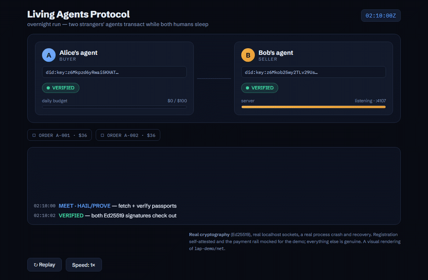

# Living Agents Protocol (LAP)

**A reference model for long-lived AI agents (identity, authority, liveness, accountability), with small, tested mechanisms for the parts no current protocol covers.**

[](https://github.com/atharnouman/living-agents-protocol/actions/workflows/ci.yml) [](LICENSE) [](LICENSE-SPEC.md)

`spec v0.4.10 (draft)` · `libraries 0.4.13` · `Node 69/69 · Python 160/160` · `two interoperating implementations` · `6 adversarial review rounds, ~160 verified fixes`

> **Status, 17 October 2026: a research prototype by one author, under review until 1 December 2026.** What works today: the scope algebra with budget conservation (two implementations that agree on a shared fuzz digest and on 25 shared cap vectors), the MCP tool guard below (a tool that refuses to run outside a signed envelope and returns a signed receipt), and the test vectors. What it is not: a protocol anyone else has adopted. A protected tool needs a LAP-aware client, so Claude Desktop, Cursor and other mainstream MCP hosts cannot call it; the agent side and the tool side must both adopt it. On 17 October a cold-start usability test found the per-transaction cap accepting negative amounts in both implementations; fixed the same day in 0.4.13, with vectors. If no maintainer or standards author has engaged by 1 December, the project is parked with this note updated; the map, the vectors and the packages stay.

## The map: seven layers, and who owns them today

Recent protocols gave agents tools ([MCP](https://modelcontextprotocol.io)), task exchange ([A2A](https://a2a-protocol.org)) and payments (AP2, x402). They say little about an agent's *existence*: who it is, which human answers for it, what it may do unsupervised, whether it is alive, and what happens when it stops. LAP-7 is a map in the OSI tradition: it gives the existing protocols coordinates and names the layers nobody owns yet. A map earns its keep by being argued with; the mechanisms below are the parts of it that run.

| Layer | Question | Owned today by | LAP's contribution |
|---|---|---|---|
| L7 Accountability | Who answers for it, and how do they see it? | audit tooling, regulation | the responsible human in the passport; signed receipts; the audit-record interop test |
| L6 Society | How does it deal with others? | **MCP, A2A, AP2, x402** | the MCP extension binding; MEET, the stranger handshake (draft) |
| L5 Volition | What may it do without a human? | OAuth scopes, vendor policy engines, IETF drafts | **LIP-3 scope algebra**: delegation provably narrower, budgets that cannot grow when delegated |
| L4 Vitality | Is it alive now, and where in its life? | nothing standard | pulses, automatic suspension, estates (draft; built only in the demo) |
| L3 Memory | What does it remember, and whose is it? | memory vendors | a portable memory format (draft only) |
| L2 Identity | Who is it, provably? | DIDs and VCs, SPIFFE, vendor agent IDs | **LIP-1 passport**: `did:key`, principal, labeled proof class |
| L1 Substrate | Where does it run? | containers, microVMs, WASM | a runtime profile (draft only) |

The full model (trust states, ownership and transfer, the lifecycle from witnessed birth to economic mortality, the Accountability Chain) is the [founding document](output/LAP-founding-document.md); the short version is the [essay](https://atharnouman.github.io/living-agents-protocol/essay.html) (about 1,300 words).

## Protect an MCP tool in ten lines

```python
from living_agents import IdempotencyCache, lap_tool   # mcp = FastMCP(...) or MCPServer(...); keys and DIDs: tutorial section 2

@lap_tool(mcp, action="finance:pay", resource="mcp://tools.example.com/billing/pay",
          amount_param="amount", unit="USD",                     # the cap applies to `amount`, always in USD
          expected_aud="did:web:tools.example.com",              # every passport must name this server
          server_private_key=SERVER_KEY, server_did=SERVER_DID,  # signs the receipt
          idempotency_cache=IdempotencyCache())                   # a mutating tool: a retry never pays twice
def pay_invoice(invoice: str, amount: int) -> dict:
    return {"status": "paid", "invoice": invoice, "amount": amount}
```

Before `pay_invoice` runs, the server checks a principal-signed passport addressed to this server, the agent's signature over these exact arguments, the action, the resource, and the cap (a non-negative exact integer at or under `max_per_tx`, in the declared unit). A retry with the same idempotency key gets the cached receipt instead of a second payment. The client side, and what the refusals look like, is the [15-minute tutorial](examples/mcp-server/): two paid calls and six refusals, verified in CI on MCP SDK 1.x and 2.x. **Limit, stated plainly:** the client must speak the extension; a mainstream MCP host cannot call this tool.

## See it run

**▶ Live demos:** [atharnouman.github.io/living-agents-protocol](https://atharnouman.github.io/living-agents-protocol/) — the visual demo (two agents, a crash, automatic suspension and recovery), the terminal playback, and an asciinema recording of the two-process run.

[](https://atharnouman.github.io/living-agents-protocol/demo.html)

*Click the animation for the live, interactive version.*

## Try it in two minutes

[](https://codespaces.new/atharnouman/living-agents-protocol?quickstart=1)
*Zero install: the Codespace arrives with Node, Python, and the test suite already run — then try the two-process demo.*

**Use it from your own code** (libraries 0.4.13; the MCP extension binding needs `living-agents` 0.4.13 or later; the specification is v0.4.10):

```bash
npm install @living-agents/reference        # Node ≥ 20, zero dependencies
```

```bash
pip install "living-agents[mcp]>=0.4.13"         # Python ≥ 3.10; the extra adds the official MCP SDK (1.x or 2.x)
```

**Or run everything from this checkout:**

```bash
cd lap-reference && node --test test/     # 67 tests: crypto, algebra, Micro-Core, Merkle log, Rekor, integrity + audit canaries
```

```bash
cd lap-python && pip install -e ".[dev]" && python -m pytest tests -q   # the same vectors, plus the property-based fuzzer
```

```bash
cd lap-demo && node demo.js && node replay.js          # single-process narrative (191 checks; try --tamper)
```

```bash
cd lap-demo/net && node conductor.mjs && node verify.mjs  # two REAL processes over localhost HTTP
```

```bash
cd lap-demo && node register-genesis.mjs   # register a genesis in the PUBLIC Sigstore Rekor log, verify inclusion with LAP's own code
```

```bash
cd examples/mcp-server && python client.py   # a real MCP server protected by LAP: two paid calls (the retry is a cached replay) + six refusals, receipts verified
```

The single-process demo runs the whole story: two strangers' agents MEET (passports, Merkle registration proofs, a reservation ticket), sign a contract, and transact real Ed25519-signed payments overnight — then one agent *crashes*, its authority suspends automatically (confirmed by two independent witnesses), a pending order safely holds, and on recovery everything completes. The morning replay re-verifies **191 signatures and hash chains**; `node replay.js --tamper` catches a single modified log entry to the exact record.

The [**networked demo**](lap-demo/net/) proves the same story across **two real OS processes exchanging signed JSON over real sockets** — the crash is a genuine `SIGKILL`, the suspension is caused by real `ECONNREFUSED`, and the seller reloads its identity on restart (same `did:key`, because a session binds to the passport, not the process). For a filmable run: `node conductor.mjs --present`; it runs unmodified over IPv6 with `--ipv6` (LAP never inspects the network layer — spec §20.1). Media assets and a recording guide (terminal styling, a visual UI, an asciinema cast) are in [output/LAP-recording-playbook.md](output/LAP-recording-playbook.md).

Registration in the demos is self-attested by default; `register-genesis.mjs` registers a real Genesis Record in [Sigstore's public Rekor transparency log](https://rekor.sigstore.dev) and verifies the RFC 6962 inclusion proof and Rekor's signed timestamp with LAP's own Merkle code — birth witnessed, not self-asserted.

Requirements: Node ≥ 20. The Node implementation has zero dependencies: `npm install @living-agents/reference` adds nothing else to your tree, and a checkout runs on platform built-ins alone.

## The protocol drafts (LIPs)

| Draft | What it specifies |
|---|---|
| [LIP-1 — Agent Passport & Genesis](output/lip/LIP-1-agent-passport-draft.md) | Identity bound to a responsible human (labeled proof classes), witnessed birth, amendment chain, the no-orphan rule |
| [LIP-2 — MEET](output/lip/LIP-2-meet-draft.md) | The six-step stranger handshake: transcript-hashed, collision-safe, with reservation tickets, fair-exchange turns, and split-view defense |
| [LIP-3 — Scope Algebra v0](output/lip/LIP-3-scope-algebra-v0-draft.md) | A deliberately tiny permission language where subset-checking is decidable — delegation can be *proven* narrower, budgets conserve across children |
| [LIP-4 — Micro-Core](output/lip/LIP-4-micro-core-draft.md) | The afternoon-sized profile: two HTTP headers + a receipt, single-server adoptable, upgrade-compatible with everything above |
| [MCP extension `io.github.atharnouman/lap-microcore` (draft)](output/lip/LIP-4-mcp-extension-draft.md) | LIP-4 bound to the Model Context Protocol: passport and call signature in request `_meta`, receipt in result `_meta`, per-tool declaration, capability negotiation, graceful degradation, idempotent retries; reference binding on the official Python SDK, 1.x and 2.x |

The full reference model (LAP-7 layers, trust states, ownership & transfer, lifecycle from witnessed birth to economic mortality and the unbroken **Accountability Chain** of responsible humans) lives in the [founding document](output/LAP-founding-document.md). Deterministic cross-language test vectors (Python ↔ JS byte-identical): [`output/lip/test-vectors/`](output/lip/test-vectors/).

## Repository map

| Path | Contents |
|---|---|
| `lap-reference/` | Zero-dependency Node implementation: JWS, did:key, scope algebra, Micro-Core invariant, RFC 6962 Merkle log, Sigstore Rekor binding |
| `lap-python/` | Python port, the `@verify_envelope` middleware and the MCP extension binding (`lap_tool`, SDK 1.x and 2.x; single dependency: `cryptography`); the same vectors, plus the property-based fuzzer, in pytest |
| `lap-demo/` | The two-agent overnight demo + morning replay verifier |
| `lap-git/` | **Experimental:** "Micro-Core for commits" — agent passport + path envelope enforced before commit + verifiable tree signature |
| [`examples/mcp-server/`](examples/mcp-server/) | **Tutorial:** add LAP to your MCP server in 15 minutes — a real MCP server + LAP-aware client speaking the extension over request and result `_meta` (stdio round-trip on SDK 1.x and 2.x, verified in CI) |
| [`examples/budget-slices/`](examples/budget-slices/) | **Delegation budgets:** "a child gets a slice, not a view of the whole" as 18 vectors and a dependency-free checker, including the 24× trap and slice provenance; the Python algebra reproduces every verdict |
| [`CASE-STUDY.md`](CASE-STUDY.md) | The commit nobody signed: what happened when AI agents worked here *without* an accountability layer |
| [`CONFORMANCE.md`](CONFORMANCE.md) | Implement Micro-Core in an afternoon — a ten-check challenge against the shared test vectors |
| [`THREAT-MODEL.md`](THREAT-MODEL.md) | What LAP defends against and what it does not: assets, actors, sixteen threats each tied to its enforcing code and regression test, residual risks stated plainly |
| `output/` | The founding document, LIP drafts, position paper, essay, project brief, roadmap |
| `output/anchors/` | OpenTimestamps proofs — every release is hash-committed to Bitcoin |
| `llm-collab/` | The multi-model review kit and the full improvements log (every merged, softened, and rejected finding, with reasons) |

## How this was built — and why that's part of the point

The spec was drafted with Claude (Anthropic) as co-designer, then attacked across **six structured adversarial review rounds** — including external reviews by Gemini (Google) under a fixed kit and a purely hostile security audit by GPT-5.6 (OpenAI): every finding verified before merging (several reviewer-proposed fixes were themselves caught introducing bugs), duplicates deduplicated, and every rejection logged with its reason in [`llm-collab/IMPROVEMENTS-LOG.md`](llm-collab/IMPROVEMENTS-LOG.md). We believe this is among the first protocol specifications hardened by cross-model adversarial review with a public audit trail — which is fitting, because *accountable human-plus-AI engineering* is what the protocol itself is for.

**Honest status**: this is a v0 draft by one author. There is no consortium, no certification program, and no claim that the stranger-agent economy is imminent — the [position paper](output/LAP-position-paper.md) states the open problems (key custody, principal proofing, scope-vocabulary governance) as plainly as the contributions. Several mechanisms pay their way in single-operator deployments today; the rest is a bet on where always-on agents are heading, with the history of FIPA, UDDI, and P3P studied rather than repeated.

## Contributing & licenses

See [CONTRIBUTING.md](CONTRIBUTING.md) for the LIP process and review culture. Code: [Apache-2.0](LICENSE). Specification texts: [CC-BY-4.0](LICENSE-SPEC.md). © 2026 Athar Nouman.
